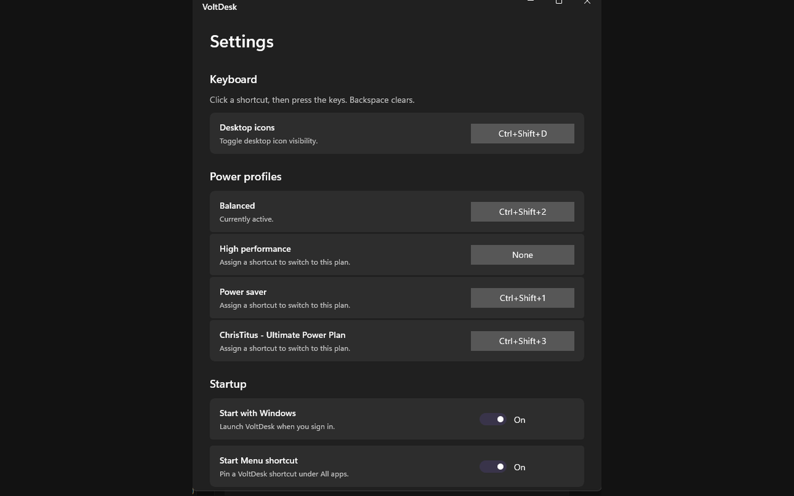

# VoltDesk

Windows tray utility for switching power plans and toggling desktop icons with keyboard shortcuts.



Switching Windows power plans takes four clicks minimum, and toggling desktop icon visibility is buried even deeper. VoltDesk puts those controls on global hotkeys you define once, then lives quietly in the system tray.

## What it does

- **Power plan shortcuts** — assign a global hotkey to each Windows power plan; press it anywhere to switch instantly
- **Desktop icon toggle** — show or hide all desktop icons with a single shortcut (default: `Ctrl+Shift+D`)
- **Tray integration** — right-click the tray icon for quick access; closing the settings window keeps VoltDesk running
- **Start with Windows** — optional autostart via the registry; no installer required for basic use
- **Start Menu shortcut** — optional pin under All apps
- **No admin rights needed** — power plan switching uses the Windows API directly

## Quick start

```bash
dotnet run
```

.NET 10 or later. The app appears in the system tray immediately. Right-click the icon for settings.

To build a standalone executable:

```bash
dotnet publish -c Release -r win-x64
```

## Building

Requirements: .NET 10.0 SDK, Windows 10 or 11.

```bash
dotnet build
dotnet publish -c Release -r win-x64
```

An Inno Setup installer script (`VoltDeskInstaller.iss`) is included for packaging.

## Releasing

Releases are cut by pushing a version tag; there is nothing to click in the GitHub UI.

1. Make sure `<Version>` in `PowerDesktopApp.csproj` matches the release (the tag also overrides it at build time).
2. Tag `master` and push the tag:

   ```bash
   git tag v1.2.3
   git push origin v1.2.3
   ```

The [Release workflow](.github/workflows/release.yml) then builds Release on `windows-latest`, attaches `VoltDesk-win-x64-v1.2.3.zip` and `VoltDesk-win-x64-v1.2.3.zip.sha256` to a new GitHub release, builds the Inno Setup installer, packs the Chocolatey package and test-installs and uninstalls it, and pushes it to the Chocolatey community feed.

Tags containing `-` (for example `v1.2.3-rc.1`) are test/prerelease tags: the GitHub release is created as a draft prerelease and the Chocolatey push is skipped. The push is also skipped on forks, if the repository is private, or if the `CHOCOLATEY_API_KEY` secret is missing; the log says which.

To produce the same zip and `.sha256` locally (output goes to the git-ignored `release\` folder):

```powershell
powershell -ExecutionPolicy Bypass -File build\release.ps1              # version from the .csproj
powershell -ExecutionPolicy Bypass -File build\release.ps1 -Version v1.2.3
```

## License

[GPL-3.0](LICENSE)

## Feedback

Questions, ideas and bug reports are welcome in [Issues](https://github.com/kilrkrow/voltdesk/issues).

---

Built by kilrkrow · [Fox & Dove](https://foxanddoveconsulting.com) · more tools at [github.com/kilrkrow](https://github.com/kilrkrow)
